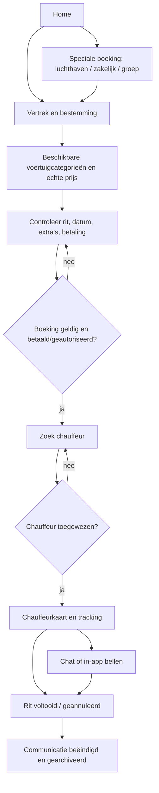

# NEXA Taxi — Implementatieplan voor Cursor

> Versie 1.0 — 14 november 2026  
> Scope: consumentenboekingsflow, realtime chat en **in-app VoIP-bellen** tussen klant en toegewezen chauffeur.  
> Dit document is een uitvoerbaar implementatiecontract, maar **niet** het bewijs dat de bestaande codebase al is onderzocht of dat de features al werken.

## 0. Startopdracht voor Cursor (kopieer dit letterlijk)

```text
Lees eerst dit volledige bestand: NEXA_TAXI_CURSOR_IMPLEMENTATIE.md.
Inventariseer de bestaande NEXA Taxi API, Expo/React Native-app, eventuele chauffeur-app,
authenticatie, tenancy, policies, ritstatussen, realtime infrastructuur, notificaties,
routekaart, payment flow en huidige UI-componenten. Stel een repo-specifiek uitvoeringsplan op
met exacte bestaande bestandspaden en mogelijke migratierisico's. Voer daarna de fases 1–8
uit met kleine, reviewbare wijzigingen. Houd compatibiliteit met bestaande klanten en API's.
Herbruik bestaande abstractions, voeg geen tweede auth- of booking-systeem toe.
Gebruik de meegeleverde assets in assets/ en de schermen in references/screens/ uitsluitend
als referentie; herbouw de UI in echte native componenten, geen screenshot als UI.
Voeg tests, logging, policies en foutafhandeling toe. Verifieer iOS en Android native builds.
Mocht een noodzakelijke credential ontbreken: implementeer veilige config en mocks,
documenteer exact de handmatige setup, en claim geen werkende productie-integratie.
Vraag alleen om secrets of externe provisioning die daadwerkelijk onmisbaar zijn.
Stop niet bij alleen een mockup: maak flows functioneel en bewijs dat met tests.
```

## 1. Productdoel en ontwerp

- **Milo komt niet in de app**: alleen voor marketing op de website.
- Consumenten-home: compact NEXA-logo/header; **Waar wil je naartoe?** als primaire actie; tegels Luchthaven / Zakelijk / Groepsvervoer; bottom navigation Home / Boeken / Ritten / Meldingen / Meer.
- Kies ophaallocatie, bestemming, datum/tijd, passagiers en bagage; toon uitsluitend werkelijk beschikbare vervoerscategorieën, regels, ETA en prijs/berekening.
- Voertuigkeuze; controleer rit; voorwaarden, betaalmethode; bevestig rit; zoek en wijs chauffeur toe; chauffeurkaart; live-tracking.
- Na **daadwerkelijke** chauffeurskoppeling: knoppen `Bellen`, `Chat`, `Deel rit`. Voor koppeling is communicatie verborgen of disabled met uitleg.
- Transparante wachttijden, duidelijke loading/empty/error states; geen nepprijzen, nepchauffeurs of gefingeerde tracking.
- De afbeeldingen onder `references/screens` zijn **concepten**. Namen, kentekens, prijzen en tijden daarin zijn fictief.

### Branding / design tokens

```ts
export const nexaTheme = {
  color: {
    navy900: '#071326', navy800: '#091D3A', navy700: '#122742',
    blue: '#1E4C97', blueBright: '#168BFA', orange: '#F57C00',
    text: '#FFFFFF', textMuted: '#B8C7DC', border: '#31547E',
    success: '#19BA83', danger: '#EF5B65', surface: '#12243C',
  },
  radius: { sm: 12, md: 18, lg: 24, xl: 32 },
  spacing: { xs: 4, sm: 8, md: 12, lg: 16, xl: 24 },
  touchTargetMin: 44,
};
```

- Gebruik toegankelijke contrasten, schaalbare tekst, safe areas, toetsenbordverplaatsing, skeleton-loading en Nederlandse vertalingen.
- SVG-iconen onder `assets/icons`; auto-PNG onder `assets/vehicles`; routebanier onder `assets/backgrounds`.
- UI is React Native, niet één grote rasterafbeelding. Render kaart met bestaande kaartprovider en echte routegegevens; route-SVG alleen decoratief, nooit als echte kaart.
- Verifieer licentie/merkgebruik voor de gegenereerde voertuigillustraties en vervang door officiële NEXA-assets indien beschikbaar.

## 2. Vereiste repo-inspectie vóór wijzigen

Leg resultaten vast in `docs/nexa-communication-audit.md`:

1. Projectstructuur, appframework/Expo SDK, EAS, bestaande iOS bundle ID / Android package en installaties van React Navigation/Expo Router.
2. Laravel/PHP-versie; migrations/Models/Enums/Policies; auth (Sanctum of bestaand); tenant context en row scopes.
3. Bestaan er `Booking`, `Ride`, `Trip`, `DriverAssignment`, `User`, `Tenant` of soortgelijke modellen? Hergebruik exact bestaande benamingen.
4. Beschikbare Laravel Reverb/Pusher/Ably setup, Redis, queue workers; push stack (Expo Push/FCM/APNs) en locatietracking.
5. Chauffeurinterface: app of web? **In-app VoIP** vereist een compatibele native app bij beide partijen; plan anders een veilige fallback of aparte chauffeur-app, maar ga niet uit van een bestaande chauffeur-app.
6. Payment provider, kostenberekening en business rules: niet dupliceren.
7. Maak een mappingtabel van dit document naar daadwerkelijke repo-bestanden.

## 3. Gewenste boekingsflow



**Ritstatussen**: hergebruik bestaande enum, documenteer de vertaling naar `draft`, `requested`, `matching`, `assigned`, `driver_en_route`, `arrived`, `in_progress`, `completed`, `cancelled`, `expired`. Geen automatische rechtstreekse overgangen die de bestaande dispatch-flow omzeilen.

**Communicatiebeleid (aanbevolen standaard):** alleen bij `assigned`, `driver_en_route`, `arrived` of `in_progress`; stopt direct bij `completed`/`cancelled`/`expired`, chauffeurwissel of accountblokkade. Een korte grace period na voltooiing is alleen met expliciete businessregel toegestaan. Server autoriseert **elke** actie opnieuw.

## 4. Architectuur

| Laag | Voorkeur | Opmerkingen |
|---|---|---|
| Backend | bestaande Laravel 12-app | Policies, Form Requests, services, queued jobs |
| Database | PostgreSQL | RLS alleen indien al gebruikt; tenant-scoping altijd afdwingen |
| Realtime chat | Laravel Reverb + private broadcast channels + Redis | Controleer bestaande broadcasting configuratie |
| Mobiel | bestaande Expo/React Native-app | iOS + Android native dev build |
| Voice | `@twilio/voice-react-native-sdk` 1.8.x of veiligere actuele stabiele compatibele versie | 1.8.1 is bekend op 14 nov. 2026; **geen 2.x preview** |
| VoIP signaling | Twilio Programmable Voice, TwiML App webhook | Laravel beslist server-side wie mag verbinden |
| VoIP push | iOS APNs VoIP/PushKit + CallKit, Android FCM | Twilio Push Credentials per platform, echte apparaten testen |
| Chat push | bestaande push-service (Expo Notifications/FCM/APNs) | Suppress bij open actieve chat om dubbele alerts te beperken |
| Monitoring | bestaande Sentry/observability | Geen inhoud of tokens loggen |

**Essentiële scheiding:** chat loopt over Laravel/WebSockets, audio over Twilio Voice. Een Twilio Voice-client `identity` is geen telefoonnummer. De klant belt niet met het privénummer van de chauffeur en omgekeerd. **Er is dus geen nummerafscherming-via-PSTN nodig zolang beide gebruikers VoIP gebruiken.** Bij optionele gewone telefoongesprekken is een aparte Twilio PSTN-bridge met gemaskeerde nummers noodzakelijk.

## 5. Datamodel (concept; map naar bestaande structuur)

**`ride_conversations`**: `id` UUID, `tenant_id`, `ride_id` unique, `status` (`open`/`closed`), `created_at`, `closed_at`; geen onbeperkt nieuwe chatrooms per boeking.

**`ride_messages`**: `id` UUID, `tenant_id`, `ride_id`, `conversation_id`, `sender_user_id`, `client_message_id` UUID, `body` TEXT (max 2000), `type` (`text`/`system`), `created_at`, `read_at`, `deleted_at` nullable. Uniek `(conversation_id, sender_user_id, client_message_id)` voor retries. Index `(conversation_id, created_at, id)`; tenant-indices waar passend.

**`ride_calls`**: `id` UUID, `tenant_id`, `ride_id`, `initiator_user_id`, `recipient_user_id`, `state` (`requested`, `ringing`, `connected`, `ended`, `missed`, `declined`, `failed`), `twilio_call_sid` nullable unique, `started_at`, `answered_at`, `ended_at`, `termination_reason`; indexes op rit/status. Voor callback-retries upsert idempotent.

**`ride_communication_events`** (optioneel): zakelijke audit-eventnaam, actor, tijd, call/message ID; géén berichttekst, audio, telefoonnummer of secret in logs.

Bewaartermijnen: stel samen met privacybeleid in; maak een scheduled purge/anonymization job. Geen call recording standaard. Geen mediasupport of attachments in v1, behalve na eigen veiligheids- en opslagontwerp.

## 6. API-contract — voorgestelde routes

Alle routes onder bestaande `/api/...` prefix en bestaand auth-mechanisme, pas naamgeving aan de repo aan. Voor elke request: geauthenticeerde actor, correcte tenant, partij in **huidige** chauffeurstoewijzing, juiste status, rate limit, validatie en expliciete Policy.

| Methode | Route | Doel |
|---|---|---|
| GET | `/rides/{ride}/conversation` | Chat metadata en unread count |
| GET | `/rides/{ride}/messages?cursor=...` | Geordende paginatie, maximaal 50 per batch |
| POST | `/rides/{ride}/messages` | `{client_message_id, body}`; idempotent |
| POST | `/rides/{ride}/messages/read` | `{up_to_message_id}` server-side begrensd |
| POST | `/rides/{ride}/calls` | `{client_request_id}` start call, controleert actieve sessies |
| GET | `/rides/{ride}/calls/{call}` | Read-only server state |
| POST | `/rides/{ride}/calls/{call}/end` | Beëindigen, idempotent |
| POST | `/voice/access-token` | Kortlevend Voice JWT voor geauthenticeerde gebruiker/device |
| POST | `/webhooks/twilio/voice` | TwiML route, **Twilio signature validatie** |
| POST | `/webhooks/twilio/status` | Status callbacks; signature + idempotentie |

Gebruik geen client-opgegeven `recipient_user_id`, telefoonnummer of Twilio Identity als autoritatieve bestemming. De server resolveert de actuele chauffeur/klant uit de rit. Request payloads met onbevoegde IDs worden geweigerd.

### Responses en fouten

- Standaard resultaat `{data: {id, ...}, meta: {...}}`; align met bestaand API-contract.
- `401`: niet ingelogd; `403`: geen bevoegdheid; `404`: rit niet toegankelijk (voorkom enumeration); `409`: rit gesloten/geen toegewezen chauffeur/al een call actief; `422`: ongeldige input; `429`: te veel berichten/callpogingen.
- Nooit provider-secret, intern telefoonnummer of volledige Twilio JWT in analytics, logs, crashreports of API-errorbody.

## 7. Realtime chat — backend

1. Install/configureer Reverb alleen indien niet aanwezig; met Redis-queue, HTTPS/WSS achter bestaande reverse proxy. Gebruik queue workers en supervisor/Coolify process management.
2. Broadcast nieuwe berichten na database-commit via `ShouldBroadcast` en `ShouldDispatchAfterCommit` of passend alternatief. Gebruik private kanaal `private-ride.{tenantId}.{rideId}` (naam kan aan repo worden aangepast).
3. In `routes/channels.php` controleer user/tenant/current assignment/status. Autorisatie voor subscriben is noodzakelijk maar **niet voldoende**: recheck bij POST en bij message read.
4. Message send: `DB::transaction`, validate, idempotency-key, persist, emit event, background push naar ontvanger. Bied retry en optimistic UI met status `sending/sent/failed`.
5. Chatlijst: cursor-paginatie, chronologische ordening, timezone ISO8601, offline retrieval, unread state en read receipts. Nieuwe berichten mogen niet verloren gaan bij disconnect.
6. Veilige tekst-only weergave, geen HTML interpretatie, geen ongevraagde URL-open, escape/normalize en rate limit, bijv. 20 berichten/minuut per gebruiker/rit (configureerbaar).
7. Maak websocket-auth voor mobiele tokens werkend zonder browser-session/cookies aan te nemen. Vertrouw geen tenant-ID uit clientstate zonder servercheck.

## 8. Bellen binnen de app — Twilio Voice

### 8.1 Providerconfiguratie

- Twilio account + API key/secret (backend only), TwiML App SID, iOS APNs VoIP credential, Android FCM credential. Provisioning en platformpush daadwerkelijk in Twilio Console configureren.
- Token server genereert Twilio `AccessToken` met `identity` en `VoiceGrant` (`outgoingApplicationSid`, `incomingAllow`, `pushCredentialSid` indien relevant). `identity` is een niet-herleidbare stabiele technische actor-ID, bijv. `nexa_u_<opaque-id>`; pas Twilio character/length limits toe.
- Access token kortlevend; tokens op nieuw device/login roteren, logout deregistreren. Secrets in secrets manager/Coolify env, nooit in app bundle. Alleen token teruggeven aan geauthenticeerde betrokken gebruiker.
- Mobiel: `npx expo install @twilio/voice-react-native-sdk` en config plugin toevoegen, daarna `expo prebuild` / EAS development build. **Expo Go werkt niet voor deze native module.**
- iOS: Microphone permission, `audio`/`voip` background modes, juiste APNs VoIP/PushKit en CallKit setup via SDK plugin; fysiek apparaat nodig voor incoming call-test.
- Android: FCM `google-services.json`, config plugin, notification permissions, foreground call integration en echte device tests.
- Controleer ook microfoontoestemming pas wanneer relevant en bied tekstchat als fallback.

### 8.2 Correcte call routing

**Belangrijk:** zet NOOIT de bestemmings-identity in de Twilio clientparams als enige autorisatie. Het mag hooguit een `call_request_id`/`call_id` zijn. Flow:

1. Klant tikt `Bellen`; mobiel POST `/rides/{ride}/calls`.
2. Laravel policy verifieert dat deze klant en toegewezen chauffeur bij dezelfde actieve rit horen, preventie dubbele sessies / call spam; maakt `ride_calls` aan.
3. Mobile haalt kortlevende Voice Access Token op, registreert device voor incoming en doet `Voice.connect(token, { params: { call_id: ... } })` volgens **daadwerkelijke SDK-signature**.
4. Twilio TwiML Application roept backend webhook aan. Laravel **verifieert X-Twilio-Signature** met de daadwerkelijke publieke request-URL, leest call-ID en Twilio identity, hercontroleert ritstatus, caller identity, actuele recipient en call state, en geeft uitsluitend server-generated TwiML `<Dial><Client>nexa_u_...` terug.
5. Chauffeur krijgt incoming call via Twilio VoIP push / native incoming UI; `accept` / `reject`; Twilio callbacks actualiseren serverstate. Mic/earpiece/speaker/mute/stop controls werken native.
6. VoIP beëindigt op hangup, ritafsluiting, herverdeling van chauffeur, blokkering of timeout. Gebruik server-side Twilio Calls REST API om actieve sessions te beëindigen indien nodig.
7. Webhook-retries en dubbele events zijn idempotent; staten mogen niet door late callbacks terug in tijd springen.

Voorkom een ontbrekende user als doel te dialen; Twilio client registrations kunnen tijdelijk offline zijn. Geef `niet bereikbaar` en bied chat als fallback. Overweeg ring timeout ~30 sec als configureerbare instelling, niet als client-enforced waarheid.

### 8.3 Eventuele telefonie buiten de app

Als chauffeur of klant geen native app heeft: voer **niet** zomaar `tel:` naar privételefoonnummers uit, want dat doorbreekt privacy. Een aparte tweede fase kan PSTN relay met Twilio Proxy/Voice/TwiML bridging, geverifieerde/nationale nummers, tariefwaarschuwing en eigen nummerafschermingsregels toevoegen. Dit valt buiten v1.

## 9. Mobiele UI-componenten

Maak herbruikbare `RideContactActions`, `RideChatScreen`, `MessageBubble`, `MessageComposer`, `IncomingCallScreen`, `ActiveCallScreen`, `DriverContactCard`, `CommunicationUnavailableBanner`, `RideTrackingScreen` in bestaande app-structuur. Paden zijn **suggesties**, ontdek echte repo-architectuur.

### `RideContactActions`

- Knop `Bellen` met `call.svg`, `Chat` met `chat.svg`, `Deel rit` met `share.svg`.
- Disabled zolang niet `assigned` of een toegestane ritstatus; explain waarom.
- Bevestig bij eerste VoIP-sessie microfoonrechten. Toon ook belstatus: `Verbinden`, `Overgaan`, `Gesprek`, `Niet bereikbaar`, `Verbinding verbroken`.

### Chat

- Topbar: chauffeur en ritcontext; realtime bubbles, eigen berichten rechts in blauw, chauffeur links op donker vlak; tijd, afgeleverd/gelezen waar betrouwbaar.
- Composer met zenden, 2000-char max, keyboard avoidance, offline retry, laad oudere berichten. Nieuwe push opent exact de juiste rit/conversatie na autorisatie.
- Bij rit voltooid: read-only conversatie gedurende retentie, geen nieuwe berichten.

### Actief gesprek

- Grote avatar-placeholder of bestaande goedgekeurde chauffeurfoto; naam uit echte backend.
- Timer pas wanneer Twilio connected; knoppen `Mute`, `Speaker`, `Ophangen`; inkomend `Accepteren` / `Weigeren`.
- Voorkom dubbele calls; UI herstelt na app background/foreground; lockscreen/native system UX (CallKit op iOS), audio interruption en Bluetooth testen.

### Assetgebruik

- **Productie:** `assets/vehicles/nexa-taxi-sedan.png` voor beeldaccent op boekings-/chauffeurkaart; `assets/backgrounds/nexa-route-banner.svg` alleen decoratief voor een card/banner; vectoriconen voor contactknoppen. Geen volledige afbeeldingen als klikbare UI.
- **Referentie:** `references/screens/01_home.png` t/m `06_live_volgen.png` tonen de gewenste visuele richting. Als tekst of layout daarin afwijkt van productregels, volgt Cursor dit document en de echte backenddata.
- Vervang het logo uit illustraties door het **officiële bestaande NEXA-logo in de codebase**. Geen nagemaakt logo uit screenshots uitknippen.

## 10. Voorbeeld van Expo-configuratie — controleer eerst bestaande app

Niet blind overschrijven: integreer onderstaande keys in bestaande `app.json`/`app.config.ts`, en gebruik echte, gescheiden dev/prod credentials.

```json
{
  "expo": {
    "plugins": ["@twilio/voice-react-native-sdk"],
    "ios": {
      "infoPlist": {
        "NSMicrophoneUsageDescription": "NEXA Taxi gebruikt de microfoon voor gesprekken met je chauffeur.",
        "UIBackgroundModes": ["audio", "voip"]
      }
    },
    "android": {
      "googleServicesFile": "./google-services.json"
    }
  }
}
```

De plugin en iOS-entitlements vereisen de actuele Twilio/Apple installatiestappen. Vul geen productie-`aps-environment` handmatig in zonder controle op signing/provisioning. Voeg andere plugins/background modes uit bestaande app niet kwijt.

### Laravel `.env.example` — namen aanpassen aan bestaand config-pattern

```dotenv
BROADCAST_CONNECTION=reverb
REVERB_APP_ID=
REVERB_APP_KEY=
REVERB_APP_SECRET=
REVERB_HOST=
REVERB_PORT=443
REVERB_SCHEME=https
TWILIO_ACCOUNT_SID=
TWILIO_API_KEY_SID=
TWILIO_API_KEY_SECRET=
TWILIO_VOICE_APP_SID=
TWILIO_VOICE_PUSH_CREDENTIAL_IOS=
TWILIO_VOICE_PUSH_CREDENTIAL_ANDROID=
TWILIO_AUTH_TOKEN=
VOICE_FEATURE_ENABLED=false
CHAT_FEATURE_ENABLED=false
```

Auth token is vereist voor signature-verificatie volgens Twilio SDK; controleer `TWILIO_AUTH_TOKEN` rol en kies geen publieke env-prefix. Bepaal PUSH-credential per platform/device en laat de JWT-verstrekking strikt server-side lopen.

## 11. Security/privacy: harde acceptatie-eisen

- `tenant A` kan NOOIT communiceren met rit van `tenant B`, ook niet met een bekende UUID, geraden websocket channel of oude valid token.
- Alleen betrokken klant en **actueel toegewezen** chauffeur; bij chauffeurwissel direct toegang oude chauffeur intrekken en device registratie/actieve sessies waar nodig beëindigen.
- Test request spoofing (`ride_id`, `recipient`, `caller`, `identity`, URL/query parameters), replay, oude tokens, concurrent calls, race conditions en webhook forgery.
- Unauthenticated Twilio callbacks alleen via cryptografisch geverifieerde handtekening; webhook URL correct achter proxy; geen `signature validation disabled` in prod.
- Geen telefoonnummer zichtbaar of gebruikt voor v1. Geen gesprekken opnemen. Chatretentie en privacyverklaring vóór livegang laten toetsen.
- SMS/telefoonkosten, VoIP-permission en netwerkfouten zichtbaar en correct afhandelen.
- Request-IDs/auditgegevens, maar nooit tokens, berichtinhoud of Voice-recordings in applicatielogs.

## 12. Tests en quality gates

### Backend

- Featuretests: klant/driver happy path, guest 401, willekeurige derden 403/404, tenant isolation, oude chauffeur na reassign, closed ride, rate limit, idempotent duplicate POST, message pagination/order/read.
- Voice: JWT identity/grants tests, forged Twilio webhook reject, valid signature accept, server resolves recipient, no client override, callback retry, race between cancel and webhook, twiml escaped, concurrent call blocked, end-call idempotent.
- Events/queue: fanout naar private channel, push job alleen naar ontvanger, geen broadcast vóór commit.

### Mobiel

- Typecheck/lint, tests voor loading/error/permission denied/offline/empty.
- iOS real-device -> Android real-device, en Android -> iOS; accepted, declined, missed, closed app, background, reconnect, Bluetooth, network drop, microphone disabled.
- EAS dev build, release candidate TestFlight/Play Internal Test; run op fysieke devices met echte Twilio credentials.
- UX-check small iPhone, large phone, dynamic text, VoiceOver/TalkBack, NL/EN.

### Productcriteria

- Zodra chauffeur is gekoppeld, verschijnt alleen diens huidige identiteit en contactopties, met server-autorisatie.
- Bericht van klant verschijnt bij chauffeur realtime; na reconnect is bericht persisted en via API beschikbaar.
- Inkomende oproep rinkelt via OS op beide ondersteunde platforms, beide kanten kunnen opnemen/ophangen, geen privételefoonnummer zichtbaar.
- Bij ritafsluiting zijn POST chat en calls geblokkeerd, actieve call wordt beëindigd; privacy en tenancy blijven intact.
- Pas `VOICE_FEATURE_ENABLED=true`/`CHAT_FEATURE_ENABLED=true` aan als de integratie end-to-end is bewezen.

## 13. Uitvoeringsfasen voor Cursor

1. **Audit**: codebase + bestaand auth/tenancy/ride-statussen in kaart; documenteer beslissingen.
2. **Design**: tokens, nav, booking/contact UI met echte componenten; integreer assets en dark/light-state.
3. **Database/API**: migrations + models + policies + conversation/messages/controllers + tests.
4. **Realtime**: Reverb private channels, reconnect, push, unread, tests.
5. **Voice backend**: Twilio service, JWT vending, voice TwiML/callback validation, audit, call state.
6. **Voice app**: Expo plugin, iOS/Android native entitlement/push, calling UI/lifecycle, actual devices.
7. **Integratie**: chauffeurtoewijzing, annulering, ritvoltooiing, privacy/tenancy, observability.
8. **Release**: staging smoke tests, feature flags, deployment checklist, rollbackplan, screenshots en testresultaten.

Maak per fase een korte changelog met files gewijzigd, tests gedraaid, eventuele afhankelijkheden, en blokkerende secrets/provisioning. Niet zelf productiecreds genereren. Niet beweren dat iOS/Android incoming calls werken zonder fysieke end-to-end test.

## 14. Levering door Cursor

- Code, migrations, policies, server routes, realtime channels, API-tests en mobiele schermen.
- `docs/nexa-communication-audit.md`, `docs/nexa-twilio-setup.md`, `docs/nexa-release-checklist.md`.
- Beschrijving van ontbrekende accountconfig en exacte teststappen per platform.
- Geautomatiseerde tests + output; lijst met open issues (geen fictieve 'alles werkt'-claim).
- Screenshots van gecompileerde schermen en evidence van chat- en VoIP-test, zonder privédata.

## 15. Officiële documentatie (geraadpleegd november 2026)

- Twilio React Native Voice: https://www.twilio.com/docs/voice/sdks/react-native
- Twilio React Native GitHub & Expo notes: https://github.com/twilio/twilio-voice-react-native
- Twilio Access Tokens: https://www.twilio.com/docs/iam/access-tokens
- Laravel Reverb 12.x: https://laravel.com/docs/12.x/reverb
- Expo + Twilio app-config: https://github.com/twilio/twilio-voice-react-native/blob/main/docs/expo/app-config.md

> **Let op**: installatie-API's en public SDK versions kunnen na publicatie veranderen. Cursor moet de versies in het daadwerkelijke project en de huidige provider-docs vóór codewijziging verifiëren.
