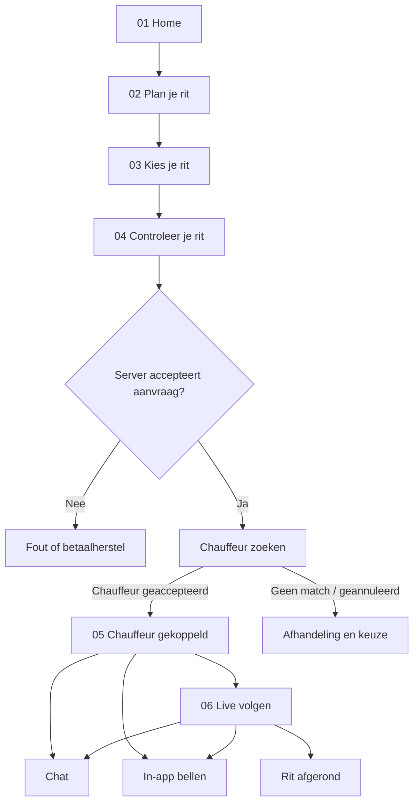

# NEXA Taxi — Pixelgerichte UI-implementatie voor Cursor

**Versie:** 1.0 · **Bron:** zes door de opdrachtgever aangeleverde, ongewijzigde PNG-schermontwerpen · **Doel:** zo getrouw mogelijke React Native/Expo-weergave, inclusief functionele boekingsflow, ritstatus en contact met chauffeur.

> **BELANGRIJK: VISUELE WAARHEID**
> De bestanden `references/01_home.png` t/m `references/06_live_volgen.png` zijn de **enige definitieve visuele bronnen**. Dit document specificeert hun structuur, maar een screenshot is een **plat rasterbeeld**. De originele afzonderlijke 3D-autolagen, nachtfoto's, merklogo's en bronbestanden zijn niet uit die PNG's terug te halen. `assets/crops/*` zijn **referentie-uitsneden met achtergrond**, geen transparante productieafbeeldingen. `assets/backgrounds/*.svg` zijn nagetekende, schaalbare **benaderingen** van de kaarteffecten. Cursor mag daarom NOOIT beweren dat een nieuwe UI byte-for-byte identiek is zonder visuele vergelijking en goedgekeurde product-assets. Gebruik bestaande originele NEXA-logo's en productfoto's uit de repository als die aanwezig zijn. Ontbrekende transparante, afzonderlijke taxi-assets markeren als `ASSET_REQUIRED` in plaats van vervalsen of een schermafbeelding met knoppen als achtergrond te gebruiken.

## 0. Cursor: voer dit plan uit

1. **Inspecteer de repo**, detecteer exacte frontend (Expo Router/React Navigation, React Native-versie, JS/TS, thema, assets, icon set, safe-area, huidige API-client), backend (Laravel, tenant-scope, ritstatus), tests en bestaande schermen. **Ga niet uit** van een vast pad of een bepaald schema.
2. Lees eerst ALLE zes `references/*.png` en deze instructie. Maak een matrix **bestaand ↔ doel** voordat je code wijzigt.
3. Voeg `assets/tokens/design-tokens.json` toe aan het bestaande designsysteem via semantische tokens en licht/donker thema. Maten in dit document zijn richtlijnen; **vergelijk altijd met screenshots**.
4. Gebruik `assets/backgrounds/route_map_{dark,light}.svg`, `route_line_overlay.svg`, de vectoriconen en foto-/auto-assets uit de **bestaande repo**. Crop-referenties zijn uitsluitend voor beoordeling; nooit complete screenshotdelen als tappable UI gebruiken.
5. Bouw 6 afzonderlijke, navigabele schermen met gedeelde componenten: `NexaHeader`, `NexaButton`, `NexaCard`, `NexaRouteHeader`, `LocationField`, `RoutePreview`, `VehicleOptionCard`, `RideStatusStepper`, `DriverCard`, `ContactActions`, `ThemeSwitch`.
6. Integreer met bestaande echte endpoints en database, zonder fictieve prijzen, chauffeurs, ETA's of routegegevens in productie. Mockdata uitsluitend via expliciete dev fixtures en zichtbare `DEMO`-context.
7. Voeg alle toestanden toe: loading, error, empty, offline, retries, geen voertuigen, geen chauffeur, geweigerde betaling, rit geannuleerd, statuswijzigingen, permission denied en klein scherm/toegankelijkheidsinstellingen.
8. Run lint, typecheck, relevante backend/frontend tests, build en screenshotvergelijking. Lever een **afwijkingenrapport** per scherm met screenshots. Wijzig geen tenant-auth of betaalstatus-flow buiten benodigde integratie.
9. Stop niet bij één PNG als `ImageBackground`: interactieve velden, knoppen en kaarten moeten echte native componenten zijn.

### Copy/paste-opdracht voor Cursor

```text
Je implementeert de NEXA Taxi klant-UI vanuit NEXA_TAXI_PIXEL_PRECISE_CURSOR.md.
Bekijk eerst alle zes originele references/PNG's, de SVG's en tokens. Inspecteer de huidige repository en identificeer bestaande components/routes/API endpoints/booking states. Maak een file-by-file plan. Bouw in fases zonder businesslogica te dupliceren. Respecteer de bestaande huisstijl en voorkom regressies. Houd de referenties exact aan voor hiërarchie, uitlijning, proporties en compositie. Gebruik originele bestaande brand-assets; gebruik screenshots/crops nooit als echte klikbare UI. Maak echte light/dark thema's; de zes referenties zijn DARK, voor LIGHT moet dezelfde layout met semantische kleurtokens worden toegepast. Implementeer geen denkbeeldige ETA, prijzen, rating, kenteken of chat-/belstatus. Schrijf tests en voeg visuele screenshots toe voor verschillen. Meld expliciet ontbrekende originele transparante assets en vraag NIET om hele projectarchief te vervangen.
```

## 1. Maten, layout en designregels

**Canvas:** alle zes referenties zijn exact **941 × 1672 px**, verhouding 0,5628 (9:16). Normaliseer coördinaten via `x_dp = x_px * screenWidthDp / 941` en `y_dp = y_px * contentViewportHeightDp / 1672` alleen als hulpmiddel voor vergelijking. Gebruik **geen absolute layout voor de gehele productie-UI**: echte iPhones hebben wisselende safe-area, zoom, Dynamic Island en tekstschaal. Ontwerp standaard voor ~390 dp breed, horizontale marge **14–20 dp**, content-`gap` **8–14 dp**, rounded cards **16–24 dp** en een vaste bottom CTA via safe-area. Scroll verticaal waar nodig.

**Kleurprincipes (benaderingen, niet exacte spectrofotometrische metingen):**

| Token | DARK | LIGHT |
|---|---|---|
| `background` | `#061329` | `#F4F8FF` |
| `surface` | `#102542` | `#FFFFFF` |
| `surfaceRaised` | `#152E50` | `#EDF4FD` |
| `text` | `#FFFFFF` | `#0A1A34` |
| `muted` | `#B7C7DF` | `#64748B` |
| `border` | `#355A86` | `#CFDDF0` |
| `accentBlue` | `#087DFF` | `#087DFF` |
| `primaryOrange` | `#FF8900` | `#F57C00` |

Gebruik oranje voor de **enige primaire CTA** en actieve Home-tab, felblauw voor tweede acties, routes en pinnen. Witte inputs mogen lichtblauw verloop bevatten. Tekst voldoende contrast, geen glows onder kleine tekst. Font is een moderne sans-serif, visueel vergelijkbaar met Inter/SF Pro; behoud projectfont indien aanwezig. Richtgroottes op 390dp: titels 25–29sp, secties 20–23sp, labels 13–15sp, subtitels 14–16sp, knoppen 16–19sp; respecteer dynamic type. Kaarten hebben een zachte donkerblauwe gradient en dunne blauwe border, afgeronde hoeken. Registreer kaarten en knoppen als design-system primitives.

**Globale header:** op alle screenshots een iOS statusbar (ECHTE systeemstatusbar, NIET als afbeelding), gecentreerd NEXA | TAXI-logo, rechts zon-/themaknop en Engelse vlag-taalwissel. Op scherm 2–6 links een terugpijl. Laat de statusbar door het OS afhandelen. Het officiële NEXA-logo moet een los asset uit bestaande projectbronnen zijn; teken nooit een benaderde merknaam als bronlogo.

**Licht/donker modus:** gebruik voorkeur uit bestaande app en native system setting, handmatige override bewaren. Theme-switch verandert componentkleuren, kaartstijl en beschikbare dag/nacht hero-assets. Geen aanname dat de modus altijd exact om 18:00 uur wisselt. Achtergronden: `route_map_dark.svg`, `route_map_light.svg`; optioneel route-overlay. Als originele dag- en nachtfoto's aanwezig zijn, wissel die; anders gebruik vectorachtergrond zonder foto en rapporteer ontbrekend asset. Losse illustratie mag de inhoud niet onderdrukken.

## 2. Assetregister: wat precies waarvoor?

| Assetpad | Gebruiken bij | Status/plaatsing |
|---|---|---|
| `references/01_home.png` | Home | **Gehele referentie**; niet als UI-background |
| `references/02_plan_rit.png` | Rit plannen | Gehele referentie |
| `references/03_kies_voertuig.png` | Voertuigkeuze | Gehele referentie |
| `references/04_controleer_rit.png` | Controleren | Gehele referentie |
| `references/05_chauffeur_gekoppeld.png` | Match bevestigd | Gehele referentie |
| `references/06_live_volgen.png` | Live tracking | Gehele referentie |
| `assets/backgrounds/route_map_dark.svg` | Kaartstrip / preview in DARK | Vector **benadering**, standalone; geen echte kaartdata |
| `assets/backgrounds/route_map_light.svg` | Kaartstrip / preview in LIGHT | Vector **benadering** |
| `assets/backgrounds/route_line_overlay.svg` | Kleine hero, decoratie | Transparante vector; combineer met background |
| `assets/backgrounds/header_base_dark.svg` | Dark fallback in header | Gradient; geen autobeeld |
| `assets/backgrounds/header_base_light.svg` | Light fallback in header | Gradient; geen autobeeld |
| `assets/crops/home_hero_scene_reference.png` | Home: taxi rechts, skyline | **Referentie-uitsnede**, bevat achtergrond; niet transparent |
| `assets/crops/planning_header_scene_reference.png` | Planrit-header | Referentie-uitsnede |
| `assets/crops/planning_route_map_reference.png` | Planrit-preview | Referentie-uitsnede, bevat labels |
| `assets/crops/vehicle_{standard,comfort,van}_reference.png` | Kies voertuig | Referentie-uitsneden; vervang door **losse** officiële foto's |
| `assets/crops/confirmation_vehicle_reference.png` | Ritsamenvatting | Referentie-uitsnede |
| `assets/crops/accepted_vehicle_reference.png` | Chauffeur gekoppeld | Referentie-uitsnede |
| `assets/crops/live_tracking_map_reference.png` | Live volgen | Referentie-uitsnede; geen echte map |
| `assets/icons/*.svg` | Alle schermen | 20 vector iconen, `currentColor`; in React Native via SVG-component/import, of bestaande icon library |
| `assets/tokens/design-tokens.json` | Thema | Semantische tokens, waarden indicatief |

**Ontbrekende losse productie-assets**, NIET in screenshot vervangbaar: `nexa-taxi-logo.svg`, `nexa-sedan-transparent.png`, `nexa-comfort-transparent.png`, `nexa-van-transparent.png`, `hero-city-night-clean.webp`, `hero-city-day-clean.webp`, echte chauffeur-profielfoto en een gekeurde, rechtenvrije taxi-autofoto. Vraag project-/designteam om de originelen; gebruik bestaande project-assets waar aanwezig. De aangeleverde screenshots blijven wel **volledig en exact** aanwezig.

## 3. Scherm 01 — Home (`references/01_home.png`)

**Visuele opbouw van boven naar beneden**:

1. Statusbar; NEXA | TAXI-logo gecentreerd op x≈300–650 px, top≈115 px. Thema-icoon en taalrechts. Achtergrond: donkerblauwe kaartlijnen en een felblauwe trajectlijn tussen blauwe startpunt en oranje eindpin bovenin. Dit is een **decoratieve kaart**, geen Google Maps.
2. Intro rond y≈282–405: lichtblauwe `Welkom terug,` en grote witte `Goed je weer te zien!`, korte oranje underline. Begroeting mag alleen 'terug' tonen bij bekende terugkerende klant; voor gast `Welkom bij NEXA Taxi`.
3. Grote cinematische zwarte sedan met oranje NEXA-branding, nachtelijke skyline en nat wegdek, midden/rechts van y≈400–760. De foto moet achter/naast de tekst blijven en mag bij small screens worden verkleind.
4. Drie even brede square-ish gradient-tiles rond y≈760–955: **Rit boeken** (oranje, wit taxi-icoon), **Mijn ritten** (blauw, wit kalender-icoon), **Account** (lichtblauw/wit, donker profielicoon). Echte `Pressable`s, minimaal 44pt hit target.
5. Grote donkerblauwe rounded container rond y≈985–1435: bovenin witte/lichtblauwe search CTA **`Waar wil je naartoe?`** met oranje pin en chevron; onderin 3 kolommen **Luchthaven**, **Zakelijk**, **Groepsvervoer** met eigen iconen en scheidingslijnen.
6. Bottom tabbar y≈1475–1640: **Home** (oranje actief), **Boeken**, **Ritten**, **Meldingen**, **Meer** (wit/blauw); gebruik safe area.

**Interactie:** `Rit boeken`, zoekveld en tab `Boeken` openen scherm 02; `Mijn ritten` opent bestaande rittenlijst; `Account` opens login/profiel; shortcuts openen de specifieke airport/business/group flow met dezelfde route/vehicle/confirm kern; `Meldingen` en `Meer` gaan naar bestaande navigatie. Geen decoratieve actieve knoppen. Voor nieuwe gasten moet boeken zonder verplichte accountregistratie mogelijk blijven als de backend dit ondersteunt.

**Pixelbewaking:** felste accent is **oranje ritboeken-tegel**, zoekveld heeft de hoogste contrast onder de drie tiles. Logo en header-taxi zijn niet per se volledig zichtbaar bij compact toestel: liever onderkant scrollbaar dan iconen overlappen.

## 4. Scherm 02 — Plan je rit (`references/02_plan_rit.png`)

**Header:** terugknop, logo, thema, taal. Titel `Plan je rit` en oranje korte underscore op links rond y≈180–264. Subtekst letterlijk `Geef je ophaallocatie en bestemming op, en bekijk direct je ritopties.` Foto zwarte NEXA sedan met skyline rechts boven de velden; leg hem met `resizeMode="contain"` op een hero-laag, niet als afgevlakte screenshot.

**Interactieve inhoud:**
- `Ophaallocatie` donkerblauwe afgeronde kaart, blauwe pin links, getoonde referentiewaarde `Hengelosestraat 12, Enschede`, right icon `locate`. Autofill huidige GPS **alleen met toestemming**; anders lege/laatstgekozen locatie. Geocoding en opgeslagen adressen.
- `Bestemming` lichtblauw/witte kaart, oranje pin links, placeholder `Waar wil je naartoe?`, swap-icoon rechts. Locatiezoeker met geocoding-resultaten en toetsenbordafhandeling.
- Kaartpreview y≈647–901 met donkere wegen, neonroute, blauwe en oranje pin, plus badge `Ca. 4,8 km · ± 12 min` uit ECHTE route-API na invullen van beide adressen. Lege bestemming = decoratieve route mag optioneel placeholder zijn, maar toon geen fictieve berekende afstand als echt.
- `Recente locaties` + `Alles bekijken`, drie lijstregels Station Enschede, Universiteit Twente, Ziekenhuis MST Enschede **als screenshotvoorbeelden, nooit als live data voor elke gebruiker**. Toon alleen eigen historische adressen of placeholders.
- `Voeg tussenstop toe` als interactief item; maximum stops volgens backendbeleid.
- Bottom oranje CTA `Bekijk ritopties` alleen enabled bij geldige pickup/destination en wanneer route/quote beschikbaar is. Bij meerdere tussenstops ook herberekenen.

**Functionele toestanden:** loading/suggesties/error GPS/offline/geen route/ongeldig adres/geen resultaten. Routes moeten bij wijziging pickup of bestemming opnieuw gecalculeerd worden. Toon overzichtelijk de kosten van eventuele tussenstops vóór bevestiging.

## 5. Scherm 03 — Kies je rit (`references/03_kies_voertuig.png`)

**Toproutekaart** rond y≈205–560: in één afgeronde grote donkerblauwe card twee adressen (blauwe pickup `Amsterdam Centraal`, oranje bestemming `Schiphol Airport (AMS)`), edit pencil naast beide. Onderin horizontale kaartstrip met gloeiende route en badge `± 22 min · 17,4 km`. Deze waarden zijn **illustratief** en variëren per boeking; niet kopiëren naar productie.

**Sectiekop:** `Kies je rit`, oranje underline. Daarna drie verticale cards met flinke fotovlakken links, naam en voertuigkenmerken in het midden, ETA+prijs rechts en ronde selectieradio rechtsboven:

- **Standaard** — `1–4 personen`, `Max. 2 koffers (± 23 kg per stuk)`, ETA illustratief `4 min`, prijs illustratief `€18,50`; oranje rand en geselecteerde cirkel in screenshot.
- **Comfort** — `1–4 personen`, `Extra comfort & meer beenruimte`, `Max. 3 koffers`, ETA `6 min`, prijs `€24,00`; niet geselecteerd.
- **Busje** — `1–8 personen`, `Max. 8 koffers (± 23 kg per stuk)`, ETA `8 min`, prijs `€32,50`; niet geselecteerd.

**Belangrijke businessregel:** gebruik de **bestaande categorieën, capaciteiten, tarieven, beschikbaarheid en matching** uit NEXA Taxi. Deze labels en prijzen zijn alleen ontwerpdata en geen tariefbelofte. Een categorie met onvoldoende capaciteit is uitgeschakeld met reden. Foto's van hetzelfde voertuigtype zijn consistent in light/dark.

**CTA:** oranje `Ga verder` onderaan. Behoud de geselecteerde category ID, actuele quote ID/expiry, passenger/baggage context. Quote bij verlopen opnieuw berekenen en zichtbaar melden.

## 6. Scherm 04 — Controleer je rit (`references/04_controleer_rit.png`)

**Boven:** header en subtiele decoratieve route, `Controleer je rit` en oranje underline. Grote samengestelde ritcard rond y≈266–560 met twee locaties (`Stationsplein 12, Amsterdam` en `Schiphol Airport (AMS)`), taxi-illustratie rechtsboven, gekozen type **Comfort**, `Max. 4 personen`, en een **geschatte** prijs `€ 42,50` (alleen dummy uit ontwerp).

**Daaronder** gestapelde afgeronde kaarten met blauwe randen:
- `Ophaaltijd`: `Wanneer wil je opgehaald worden?`, segment `Nu` / `Later` met datum/tijd picker bij Later, tijdzone correct bewaren.
- `Betaalmethode`: iDEAL / Creditcard zoals in screenshot. Alleen payment method tonen als werkende provider- en checkout-flow beschikbaar; iDEAL niet als éénklik direct-debite beloven. Hergebruik bestaande betaalintegratie.
- `Extra wensen`: schakelaars `Kinderzitje`, `Extra bagage`, rij `Opmerking voor chauffeur` inclusief karakterlimiet en moderatie. Label bij kinderzitje is indicatief; details (leeftijd/maat) in subflow.
- `Zakelijke factuur?`: optionele bedrijfsgegevens/factuurvoorkeur alleen indien ondersteund; BTW/invoice rules server-side.
- Oranje `Rit bevestigen` als bottom CTA.

**Cruciale validatie:** controleer adressen, categorie, beschikbaarheid, quote, aanvullende kosten, betaalstatus en ritstatus **op de server**. CTA moet dubbele taps idempotent afhandelen. Toon heldere bevestiging dat de aanvraag is ingediend versus chauffeur daadwerkelijk geaccepteerd. Geen `success` tonen voordat de backend dat bevestigt.

## 7. Scherm 05 — Je rit is bevestigd / chauffeur gekoppeld (`references/05_chauffeur_gekoppeld.png`)

**Let op ritstatusverschil:** screenshot zegt `Je rit is bevestigd` én `Er is een chauffeur aan je rit gekoppeld`. Render dit specifieke scherm **uitsluitend** als backend-state daadwerkelijk `driver_assigned`/`driver_accepted` is. Tijdens zoeken eerst `Chauffeur zoeken` met spinner, wachttijd, annuleren en geldige retries. Voor vooraf ingeplande rit kan `Boeking bevestigd; chauffeur volgt later` een aparte state zijn.

**Visuele elementen:** decoratieve route boven, groene check in ring links, witte titel en lichtblauwe ondertitel. Groot driver-card rond y≈370–712 met foto links, naam `Yusuf` **alleen mock**, sterrenrating `4,9 (1.284 ritten)` **alleen mock**, model `Mercedes E-Klasse`, kenteken `K-374-DV` **alleen mock**, auto rechts/onderin en ETA `Aankomst over 4 min` **alleen mock**. Echte data uit toegewezen chauffeur/voertuig; toon geen foto/rating als niet beschikbaar.

Daaronder locatiecard `Ophalen` / `Bestemming`. Twee grote contactknoppen: **`Bel chauffeur`** oranje, **`Chat`** blauw. Daarna verticale tijdlijn met `Boeking bevestigd` (groen), `Chauffeur onderweg` (blauw), `Aankomst` en `Bestemming` (nog open). Onderaan oranje CTA `Live volgen`.

**Contactrechten:** knoppen alleen ingeschakeld als chauffeur is toegewezen, huidige gebruiker bevoegd is, ritstatus geldig is en service beschikbaar is. In-app chat = realtime private 1:1 ride-scoped channel met server auth; in-app bellen = VoIP-oplossing met APNs/CallKit en Android telecom/notificaties, korte geldige tokens, server-side call session en auditlogs; telefoonnummer afschermen. Maak retry, no-answer, hang-up, deny microphone permission en offline fallback. Start geen echte oproep zonder credentials/native installatie. Beide functies sluiten automatisch na de toegestane ritfase.

## 8. Scherm 06 — Live volgen (`references/06_live_volgen.png`)

**Layout is afwijkend:** boven tot circa 45% van het scherm een **echte interactieve kaart** met donkere tile-stijl, blauwe gloedroute, start/eindmarker, klein taxi-icoon op live positie, `Chauffeur onderweg`, `Live tracking` badge, tooltip pickup/destination en `Aankomst over 6 min`. Kaart moet afkomstig zijn van de bestaande echte Maps-provider; het meegeleverde `live_tracking_map_reference.png` is **uitsluitend compositiereferentie**, NIET gebruiken voor navigatie/live tracking. Bied toegankelijk routeoverzicht bij kaartfout.

Onderste ~55% een afgerond, verhoogd bottom sheet met een grabber, chauffeursfoto **Ali Yilmaz** (dummy), verified marker uitsluitend na echte verificatie, rating **4,9 (2.384 ritten)** (dummy), voertuig `Mercedes-Benz E-Klasse`, kenteken `NEXA-428` (dummy), ETA-bar `6 min / 10:30` (dummy). Daaronder horizontale ritprogress `Rit bevestigd` → `Chauffeur onderweg` → `Op locatie` → `Aangekomen`. Rij met oranje **Bel**, blauw **Chat** en licht **Deel rit**. Twee overzichtkaarten onder: `Bestemming` en `Betalingsschatting`.

**Realtime:** updates alleen via geautoriseerde ritkanalen, location timestamps en stale-indicator wanneer locatie ouder is dan threshold; geen locaties van andere tenants of chauffeurs tonen. Markers en ETA synchroniseren met echte route API; onderscheid chauffeur-naar-pickup van rit-naar-destination. Deel rit via tijdelijk, opzegbaar link/token, minimale informatie en beperkte bewaartijd. Als de app backgrounded is: hervatten, resubscribe, laatste geldige update tonen.

## 9. Navigatie en bron van waarheid



- Gebruik **server states**, niet schermnaam, als waarheid. Definieer mapping op bestaande ritstatussen, niet blind nieuw enum introduceren.
- Haal tarieven, adressen, driver assignment, ETA, kenteken, ratings, auto-afbeelding, payment state en live coordinates uit **bestaande APIs** of gedocumenteerde extensies.
- Multitenancy: autorisatie `tenant_id + ride_id + participant_id`; chauffeurcontact en tracking alleen voor deze gekoppelde rit. Geen cross-tenant exposure.
- Gast-/ingelogde flows: respecteer huidige identificatie-/authstrategie, gebruik tijdgebonden booking tokens als backend dit ondersteunt.
- Overweeg bij responsive layouts: portrait, kleine telefoons (320dp), grote iPhones, Android, accessibility text scale 1.3/1.6, landscape fallback. Geen afgesneden CTA's.
- Gevoelige beelden/logs: geen production debug logging van telefoonnummers, exacte routehistorie, credentials, tokens of chatinhoud.

## 10. Realtime chat en in-app bellen — technische checklist

**Chat (Laravel + bestaande realtime stack):** voeg alleen ontbrekende tabellen/services toe. Message-model: `id, tenant_id, ride_id, sender_user_id, body, sent_at, read_at, deleted_at` + indexen. Backend autorisatie bij ophalen en zenden, payload validatie, rate limiting, paginatie, berichtenvolgorde, retry met client UUID/idempotency, read receipts, push met minimale inhoud en scheiding tussen chat/driver system events. Private broadcast op `{tenant}.{ride}.{participant}` met Laravel Broadcasting/Reverb of bestaande provider. Fallback HTTP polling bij websocket-fout. Bewaartermijn en privacy volgens beleid.

**Voice:** scheid app Voice SDK, server token issuance, call lifecycle en native push. Twilio Voice is één mogelijke provider, **niet stilzwijgend afdwingen**. Verifieer actuele compatibiliteit met bestaande Expo SDK, EAS, iOS CallKit/APNs VoIP en Android permissions/notifications. iOS vereist native entitlement/configuratie en real-device tests; Expo Go alleen is niet genoeg. Backend autoriseert beide partijen, verstrekt **kortlevende** credentials, gebruikt webhook-signature-verificatie, laat alleen ride-participants verbinden, maskeert privételefoonnummers en beëindigt gespreksrecht na ritafhandeling. Test foreground/background/terminated, inkomend, gemist, geweigerd, mic-denied, slechte verbinding en push-token-vernieuwing.

**Niet doen:** Twilio secret in app, onbeveiligde publieke realtime channels, private telefoonnummers in UI, dummy-kentekens als feitelijke voertuigdetails, automatisch starten van audio bij openen van de pagina.

## 11. Letterlijke tekstlabels (NL)

| Scherm | Verplichte zichtbare tekst |
|---|---|
| 01 | `Welkom terug,`, `Goed je weer te zien!`, `Rit boeken`, `Mijn ritten`, `Account`, `Waar wil je naartoe?`, `Luchthaven`, `Zakelijk`, `Groepsvervoer`, `Home`, `Boeken`, `Ritten`, `Meldingen`, `Meer` |
| 02 | `Plan je rit`, `Ophaallocatie`, `Bestemming`, `Recente locaties`, `Alles bekijken`, `Voeg tussenstop toe`, `Bekijk ritopties` |
| 03 | `Kies je rit`, `Standaard`, `Comfort`, `Busje`, `Ga verder` |
| 04 | `Controleer je rit`, `Ophaaltijd`, `Nu`, `Later`, `Betaalmethode`, `iDEAL`, `Creditcard`, `Extra wensen`, `Kinderzitje`, `Extra bagage`, `Opmerking voor chauffeur`, `Zakelijke factuur?`, `Rit bevestigen` |
| 05 | `Je rit is bevestigd`, `Er is een chauffeur aan je rit gekoppeld.`, `Bel chauffeur`, `Chat`, `Boeking bevestigd`, `Chauffeur onderweg`, `Aankomst`, `Bestemming`, `Live volgen` |
| 06 | `Chauffeur onderweg`, `Live tracking`, `Aankomst over`, `Bel`, `Chat`, `Deel rit`, `Verwachte aankomst (ETA)`, `Bestemming`, `Betalingsschatting` |

Vertalingen via bestaande i18n structuur en Engelse sleutelmap toevoegen; taalwissel schakelt de getoonde taal, geen hardcoded Nederlandse tekst buiten vertaalbestanden.

## 12. Pixelreview en acceptatiecriteria

**Screenshot-gates:** genereer **6 DARK screenshots** met dezelfde verhoudingen als de zes originelen en **6 LIGHT screenshots** met identieke inhoud/composities en andere semantische thema's. Leg referentie en implementatie op 50% opacity over elkaar. Laat QA controleren: header-/logo-positie, hero-compositie, snijrand voertuig, tile-grootten, card borders/radii, sectiehoogten, typografie, pictogrammen, offsets, selectie, CTA en bottom safe area. Screenshot-diff is hulpmiddel; tekstverschil door data is toegestaan, layout-regressies niet.

**MUST PASS**:
1. Alle 6 schermen als echte react-native native UI gerenderd, klikbaar, bereikbaar en terugnavigeerbaar.
2. Dark/Light door icon en system preference, zonder flits of ontbrekende assets.
3. Geen demo-waarden getoond als live data; echte prijs/ETA/driver door backend bepaald.
4. Geen progress naar chauffeur-gekoppeld zonder acceptatie; laden en annuleren werken.
5. Geen cross-tenant chat/voice/tracking; permissions geverifieerd server-side.
6. Geen screenshot-delen als volledige klikbare lagen; iconen en teksten toegankelijk.
7. Tests: unit, component, E2E happy + error paths; iOS/Android real-device checks.
8. Alle ontbrekende originele assets gemeld in `ASSET_GAPS.md` met fallback en prioriteit; geen stilzwijgende vervanging.

## 13. Volgorde van oplevering in Cursor

**Fase 1** repo-inventarisatie / dependencies / design tokens → **Fase 2** shared components + theme → **Fase 3** 01+02 → **Fase 4** 03+04 + server quote/booking → **Fase 5** chauffeurzoek/05/06 + realtime → **Fase 6** chat + voice inclusief native permissions → **Fase 7** screenshotreview, regressietests, licht/donker iOS+Android. Maak na iedere fase concrete `changed files`, uitgevoerde tests en een lijst blockers. Niet doen alsof de complete implementatie klaar is totdat echte backend- en device-integratietests slagen.

---

### Rechten/veiligheid

De merk- en auto-afbeeldingen in referenties kunnen logo's van derden en gegenereerde tekst bevatten. Controleer licenties, logo-/merkgebruik en afbeeldingskwaliteit voor productie. Reconstructies zijn geen garantie op een exact oorspronkelijk Photoshop-/Figma-ontwerp.
